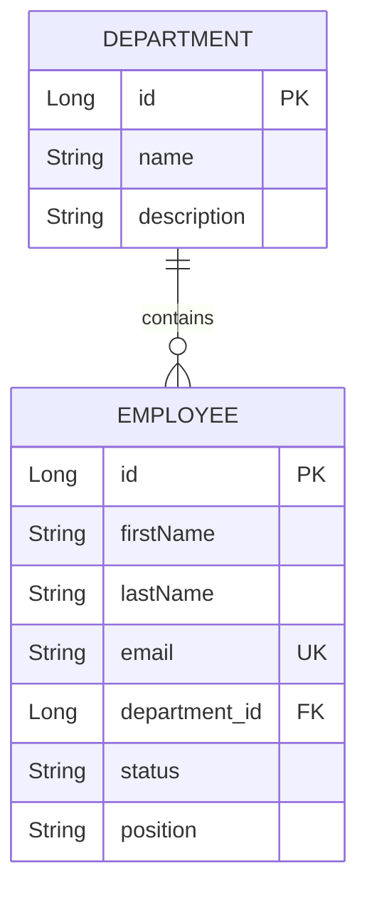

# Employee Management System – Backend

A RESTful backend application built with **Java and Spring Boot** to manage employees and departments. The application provides CRUD operations, handles employee-department relationships, validates incoming requests, and persists data in a MySQL database.

This backend is part of a full-stack Employee Management System, with a separate frontend built using React and TypeScript.

## Technologies

| Technology | Purpose |
|---|---|
| Java 17 | Programming language |
| Spring Boot 4.1.0 | Backend application framework |
| Spring Web MVC | REST API development |
| Spring Data JPA | Database access and persistence |
| Hibernate | ORM implementation |
| MySQL | Relational database |
| Jakarta Bean Validation | Request data validation |
| Maven | Dependency and project management |
| Postman | API testing |

## Features

- **Employee Management:** Create, retrieve, update, and delete employee records.
- **Department Management:** Create, retrieve, update, and delete departments.
- **Employee-Department Relationship:** Associate each employee with a department.
- **Filtering by Department:** Retrieve employees belonging to a specific department.
- **Data Validation:** Validate incoming requests using Jakarta Bean Validation.
- **DTO Mapping:** Separate API data transfer objects from database entities.
- **Exception Handling:** Handle missing resources and database integrity conflicts.
- **RESTful API:** Expose HTTP endpoints that communicate using JSON.

## Architecture

The application follows a layered architecture to separate responsibilities and make the code easier to maintain.

```text
src/main/java/me/employeemanagementsystem/
│
├── controller/
│   ├── DepartmentController.java
│   ├── EmployeeController.java
│   └── TestController.java
│
├── dto/
│   ├── DepartmentDto.java
│   └── EmployeeDto.java
│
├── entity/
│   ├── Department.java
│   └── Employee.java
│
├── exception/
│   ├── GlobalExceptionHandler.java
│   └── ResourceNotFoundException.java
│
├── mapper/
│   ├── DepartmentMapper.java
│   └── EmployeeMapper.java
│
├── repository/
│   ├── DepartmentRepository.java
│   └── EmployeeRepository.java
│
├── service/
│   ├── DepartmentService.java
│   ├── EmployeeService.java
│   └── impl/
│       ├── DepartmentServiceImpl.java
│       └── EmployeeServiceImpl.java
│
└── EmployeeManagementSystemApplication.java
```

### Layer responsibilities

- **Controller:** Defines REST endpoints, receives HTTP requests, and returns HTTP responses.
- **Service:** Handles application logic, including resource lookups and employee-department assignments.
- **Repository:** Uses Spring Data JPA to interact with the database.
- **Entity:** Represents the database tables and their relationships.
- **DTO:** Defines the data exchanged between the frontend and backend.
- **Mapper:** Converts entities into DTOs and vice versa.
- **Exception:** Handles application errors, including missing resources and database integrity violations.

## Database Design

The application uses two main entities: `Department` and `Employee`.

A department can have multiple employees, while each employee must belong to one department. This relationship is implemented using JPA's `@ManyToOne` mapping.



### Department

| Field | Description |
|---|---|
| id | Unique department identifier |
| name | Department name (required and unique) |
| description | Optional department description |

### Employee

| Field | Description |
|---|---|
| id | Unique employee identifier |
| firstName | Employee's first name |
| lastName | Employee's last name |
| email | Employee's unique email address |
| departmentId | ID of the employee's department |
| status | Employee status |
| position | Employee job position |

## API Endpoints

The API is available locally at `http://localhost:8080`.

### Department Endpoints

Base path: `/api/departments`

| Method | Endpoint | Description |
|---|---|---|
| POST | `/api/departments` | Create a department |
| GET | `/api/departments` | Retrieve all departments |
| GET | `/api/departments/{id}` | Retrieve a department by ID |
| PUT | `/api/departments/{id}` | Update a department |
| DELETE | `/api/departments/{id}` | Delete a department |

### Employee Endpoints

Base path: `/api/employees`

| Method | Endpoint | Description |
|---|---|---|
| POST | `/api/employees` | Create an employee |
| GET | `/api/employees` | Retrieve all employees |
| GET | `/api/employees/{id}` | Retrieve an employee by ID |
| GET | `/api/employees/department/{departmentId}` | Retrieve employees by department |
| PUT | `/api/employees/{id}` | Update an employee |
| DELETE | `/api/employees/{id}` | Delete an employee |

### Connection Test

| Method | Endpoint | Description |
|---|---|---|
| GET | `/api/test-connection` | Verify that the backend API is responding |

Example response:

```json
{
  "message": "Connection Successful!"
}
```

## Example Requests

The API accepts and returns JSON data.

### Create a Department

**POST** `/api/departments`

```json
{
  "name": "Engineering",
  "description": "Software development and technical operations"
}
```

### Create an Employee

**POST** `/api/employees`

```json
{
  "firstName": "Jane",
  "lastName": "Doe",
  "email": "jane.doe@company.com",
  "departmentId": 1000,
  "status": "Active",
  "position": "Software Developer"
}
```

The `departmentId` must correspond to an existing department.

## Validation and Exception Handling

Incoming requests are validated using Jakarta Bean Validation annotations.

Some of the implemented validation rules include:

- Department names are required and must contain between 2 and 50 characters.
- Employee first and last names are required and must contain between 2 and 50 characters.
- Employee emails must contain a valid email format.
- Employee department IDs, status, and position are required.
- Employee status and position must contain between 2 and 50 characters.
- Department descriptions have a maximum length of 255 characters.

The application also includes exception handling for common situations:

- **404 Not Found:** Returned when an employee, department, or requested resource does not exist.
- **409 Conflict:** Returned when a department cannot be deleted because employees are still associated with it.

## Getting Started

Follow these steps to run the backend locally.

### Prerequisites

Make sure you have installed:

- Java 17 or later.
- MySQL 8 or a compatible MySQL installation.
- Git.
- An IDE such as IntelliJ IDEA (optional).
- Postman (optional, for API testing).

### 1. Clone the Repository

```bash
git clone https://github.com/JandierR/employee-management-system.git
```

Navigate into the project directory:

```bash
cd Employee-management-system
```


### 2. Create the MySQL Database

Open MySQL and execute:

```sql
CREATE DATABASE employee_db;
```

The application uses this database to store employee and department information.

### 3. Configure Database Credentials

Open `src/main/resources/application.properties`.

Configure the database connection using environment variables:

```properties
spring.application.name=Employee-management-system

spring.datasource.url=jdbc:mysql://localhost:3306/employee_db?useSSL=false&serverTimezone=UTC&allowPublicKeyRetrieval=true
spring.datasource.username=${DB_USERNAME:root}
spring.datasource.password=${DB_PASSWORD}

spring.datasource.driver-class-name=com.mysql.cj.jdbc.Driver

spring.jpa.hibernate.ddl-auto=update
spring.jpa.show-sql=true
spring.jpa.properties.hibernate.format_sql=true
```

Set the following environment variables before running the application:

- `DB_USERNAME`: Your MySQL username.
- `DB_PASSWORD`: Your MySQL password.

The `spring.jpa.hibernate.ddl-auto=update` setting allows Hibernate to update the database schema based on the entity mappings. It is intended for development environments.

### 4. Run the Application

You can start the application using the Maven wrapper.

**Windows:**

```bash
mvnw.cmd spring-boot:run
```

**Linux / macOS:**

```bash
./mvnw spring-boot:run
```

Alternatively, if Maven is installed:

```bash
mvn spring-boot:run
```

Once the application starts successfully, the API will be available at:

`http://localhost:8080`

## API Testing

The REST endpoints can be tested using Postman or another API client.

You can test the main operations, including:

- Creating and retrieving departments.
- Creating employees and assigning them to departments.
- Updating employee and department information.
- Filtering employees by department.
- Deleting records.
- Checking the backend connection.

The project currently includes a Spring Boot application context loading test.

## Frontend Integration

This backend is designed to work with a separate frontend application built with React and TypeScript.

The frontend communicates with the REST API through HTTP requests using Axios. The backend processes those requests, applies the application logic, and interacts with MySQL through Spring Data JPA.

**Frontend Repository:**  
[Employee Management System – Frontend](https://github.com/JandierR/employee-management-system-frontend)

The backend currently allows cross-origin requests from the local frontend development server at `http://localhost:5173`.

## Author

**Jandier R.**

[GitHub Profile](https://github.com/JandierR)
